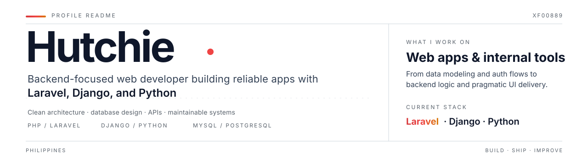

<!-- xf00889 · GitHub profile · all assets live in this repository root -->
<!--
Brand-mark credits: Laravel, Python, and PHP graphics are vector brand marks.
Laravel & PHP icon silhouettes adapted from Font Awesome Free 6.7.2 (CC BY 4.0): https://fontawesome.com/license/free
Python two-color mark sourced from Iconify-compatible Python vector bundled with Gradio.
Django icon from Simple Icons (CC0 1.0), based on Django's official logo: https://www.djangoproject.com/community/logos/
Trademarks remain the property of their respective owners. No endorsement implied.
-->

<picture>
  <source media="(prefers-color-scheme: dark)" srcset="./header-dark.svg" />
  <source media="(prefers-color-scheme: light)" srcset="./header-light.svg" />
  
</picture>

I build web applications with a backend-first mindset — designing data structures, building application logic, and shaping interfaces that stay practical as projects grow.

My strongest stack is **Laravel / PHP**, but I also work with **Django and Python**, especially when a project calls for clean architecture, reliable APIs, and maintainable systems.

  
  
  

##  What I work with

| Area | Tools & strengths |
| :--- | :--- |
| **Backend** | Laravel, PHP, Django, Python, REST APIs, authentication, authorization |
| **Database** | MySQL, PostgreSQL, Eloquent ORM, migrations, relational data modeling |
| **Frontend** | Blade, Tailwind CSS, JavaScript, HTML, CSS, Vite |
| **Workflow** | SDLC (Agile / Waterfall), Git, GitHub, testing, debugging, deployment |

##  What I focus on

- Building **web applications and internal tools** with solid backend structure.
- Designing systems around **clear workflows, user roles, and maintainable data models**.
- Writing code that stays understandable as features expand.
- Delivering interfaces that are simple, usable, and connected to strong backend logic.

##  How I approach a build

I follow the **Software Development Life Cycle (SDLC)**, from requirements gathering and planning through system design, development, testing, deployment, and maintenance.

I adapt the approach to the project: **Waterfall** when requirements and milestones are clearly defined, or **Agile** when feedback and evolving needs call for iterative delivery. In either case, I focus on clear documentation, reliable functionality, and code that's practical to maintain.

<picture>
  <source media="(prefers-color-scheme: dark)" srcset="./footer-dark.svg" />
  <source media="(prefers-color-scheme: light)" srcset="./footer-light.svg" />
  
</picture>
